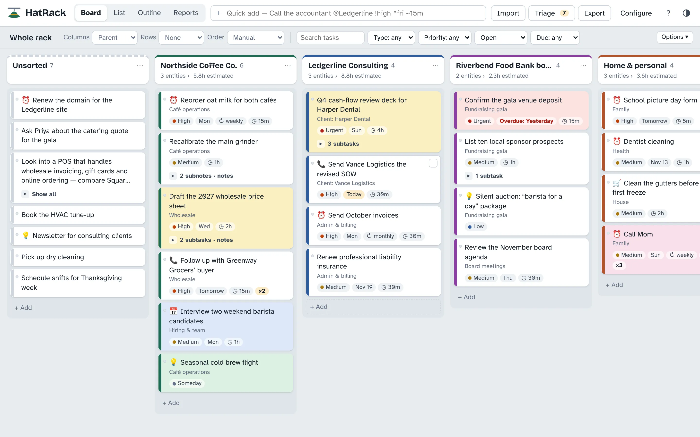

# HatRack

**Every task, on the right hat.** A lightweight visual sorter for entrepreneurs who run several businesses, projects and obligations at once. Paste in the long, messy to-do lists you collect everywhere, sort them onto your parents, entities and sub-branches, nest subtasks, then export each sector to the task app you actually work in.



- **No install, no server.** The app is a single `index.html`. Open it, or host it free on GitHub Pages.
- **Private by default.** Everything is saved in your browser on your device. Nothing is uploaded.
- **Illustrated guide built in.** Help (?) → *Visual guide*, or open `guide.html`. Every screen, menu and setting is annotated, with separate paths for daily use and for setting up.

---

## What's in this folder

| File | What it is |
|---|---|
| `index.html` | The app |
| `guide.html` + `guide/` | The visual guide and its screenshots (keep the folder next to the page) |
| `apple-touch-icon.png`, `icon-192.png`, `icon-512.png`, `manifest.webmanifest` | Home-screen icons and install support for phones |
| `.nojekyll` | Tells GitHub Pages to serve the files as they are |
| `src/`, `build.py`, `guide-src/` | Source, if you want to change the app (optional — not needed to run it) |

## Put it on GitHub Pages (5 minutes)

1. On GitHub, click **New repository**. Name it `hatrack` (or anything). On a free plan the repository must be public for Pages.
2. Click **uploading an existing file** and drag in **everything in this folder**, including the `guide` folder and `.nojekyll`. Commit.
3. Go to **Settings → Pages**. Under **Build and deployment**, set **Source** to *Deploy from a branch*, choose **main** and **/ (root)**, then **Save**.
4. After a minute the app is live at `https://<your-username>.github.io/hatrack/` and the guide at `…/hatrack/guide.html`.

Prefer the command line?

```bash
git init hatrack && cd hatrack
# copy everything from this folder in here
git add . && git commit -m "HatRack"
git branch -M main
git remote add origin https://github.com/<your-username>/hatrack.git
git push -u origin main
```

To run it without GitHub, double-click `index.html`.

### Add it to a phone

- **iPhone:** open the address in Safari → Share → **Add to Home Screen**. It gets the HatRack icon.
- **Android:** Chrome menu → **Add to Home screen** / **Install app**.

The home-screen app keeps its own data, separate from the browser tab. Move tasks across with Configure → Data → Download backup, then Restore.

---

## How it works

Your work is organized as a tree you define in **Configure → Groups & levels**:

```
Parent              →  Entity          →  Sub-branch
Northside Coffee    →  Wholesale       →  Grocery accounts
Personal            →  Health
```

Rename the levels to fit (Business / Department / Project…). Each task hangs on one spot in the tree and has a **type**, **priority**, **status**, **estimated time**, **due date**, **repeat**, tags, source, a **card color**, notes, **subnotes** (a checklist), **subtasks** (full tasks inside it, up to three levels), attachments and any custom fields you add.

### 1 · Bring your notes in — Import (`I`)

Paste a long list, open a `.txt` / `.md` / `.csv` file, or drop text onto a board column. A live preview shows where every line will land before anything is saved.

- Headings (`Northside:`, `# Personal`, ALL-CAPS lines) become groups; existing names and keywords are matched.
- Indented lines become **subnotes** or **subtasks** — your choice.
- Blocks separated by blank lines become one task each (first line = title, the rest = notes).
- Spreadsheets with a header row map columns like Title, Notes, Project, Due, Priority, Estimate, Color and Parent ID. Todoist CSV exports import too.
- Keywords on each group auto-sort notes; type keywords turn “Remind me to…” into a Reminder.
- The same reminder written five times becomes one card marked **×5**.

### 2 · Sort visually — Board

- **Drag** a card to a column to set that field. **Drop on the middle of another card to make it a subtask.** Drop on a card's top or bottom edge to place it there. **Alt/Option-drag** copies.
- **Long entries fold to three lines.** “Show more” on a card opens its notes, subnotes and subtasks; Options → *Expand every card* opens them all.
- **Right-click a card** for color, add subtask, nest under…, move to…, duplicate.
- **Click a column name** to open that group and sort into the level below.
- **Columns** and **Rows** can be any field. **Select** cards (`Ctrl/⌘`-click, `Shift`-click, tick box) and press `1`–`9`, or use the bar at the bottom.
- **Triage** (`T`) walks through unsorted tasks one at a time.

### 3 · Review — List, Outline, Reports

- **List:** sortable table with in-place editing; subtasks show their parent.
- **Outline:** a document by Parent → Entity → Sub-branch. **Drag** tasks to reorder, move them between groups, or nest them; drag subnotes between tasks. Copy as Markdown, download, or print to PDF.
- **Reports:** open work and hours by group, overdue, the next 14 days, priorities, types, statuses, repeats you keep writing down.

### 4 · Send it on — Export (`E`)

| Format | Use it for | Notes |
|---|---|---|
| **Todoist CSV** | Todoist | Sections, p1–p4, durations, repeats; subtasks become Todoist sub-tasks. 300 tasks per project — use *one file per section*. |
| **Asana CSV** | Asana | *Add tasks via → CSV*. Subtasks arrive as tasks marked “Subtask of …”. |
| **Spreadsheet CSV** | Excel, Google Sheets, Notion, Airtable, ClickUp, Monday | Every level, Parent task, Parent ID and Color are columns (re-importable with the hierarchy). |
| **Plain list** | Trello, Apple Reminders, Things, Microsoft To Do | Subtasks are indented. |
| **Markdown checklist** | Obsidian, Notion, GitHub | Nested checklists. |
| **Calendar (.ics)** | Google, Outlook, Apple Calendar | Dated tasks as all-day events; repeats keep their schedule. |
| **HatRack file** | Another computer | Configure → Data → Restore. |

### For admins: share one structure with a team

HatRack has no accounts. The person who sets it up can **Configure → Data → Download setup template** (groups, levels, keywords, types, priorities, statuses, durations, fields — no tasks) and share it. Everyone else loads it with **Restore → Apply setup**, which adds what's missing (matched by name) and keeps their tasks.

## Shortcuts you can type in any task

| Type | Meaning | Examples |
|---|---|---|
| `@Group` | where it goes | `@northside` `@Ledgerline/Admin` `@"Home & personal"` |
| `#Type` | type; other hashtags become tags | `#Reminder` `#idea` `#client` |
| `!priority` | by name or position | `!high` `!1` |
| `~time` | estimated time | `~15m` `~1h30m` `~2d` |
| `^date` | due date | `^today` `^fri` `^11/14` `^+3d` `^eom` |
| `*repeat` | repeating | `*daily` `*weekdays` `*weekly` `*monthly` `*yearly` |

## Keyboard

`N` quick add · `I` import · `T` triage · `E` export · `G` guide · `?` shortcuts · `1`–`9` move selection · `Ctrl/⌘ C / V / D` copy, paste, duplicate · `Delete` · `Ctrl/⌘ Z` undo · `→ / ←` expand or fold the focused card · `Esc` close.

## Your data

- Saved in your browser for the address you open HatRack from. A different browser, device or address starts empty; clearing site data erases it. **Back up** from Configure → Data.
- **Attachments** need no extra software: links are stored with the task; files go in the browser's built-in database (IndexedDB). Tick “Include stored attachment files” when backing up to move them.

## Changing the app

The app is assembled from `src/` (one stylesheet, a page shell and numbered script files). Edit those, then run `python3 build.py` to rebuild `index.html`. To refresh the guide's screenshots after changing the app: `pip install playwright pillow`, then `python3 guide-src/capture.py` and `python3 guide-src/build_guide.py`.

## Not included (yet)

- Live syncing between devices or a shared team board — that needs a backend (for example Supabase).
- Touch drag-and-drop varies by phone browser; on phones, tick cards and use **Move to…** or **Nest under…**.
