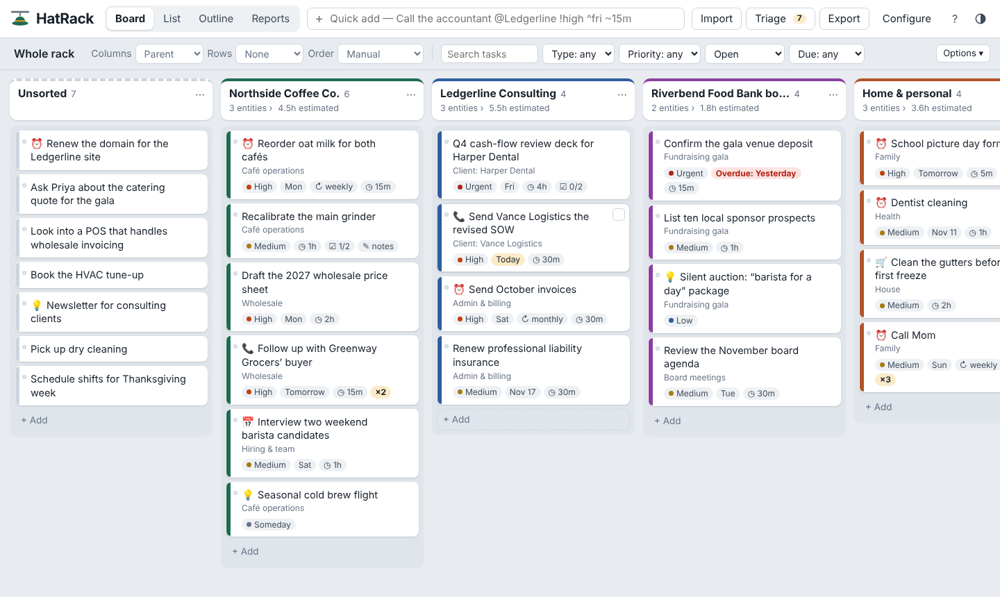

# HatRack

**Every task, on the right hat.** A lightweight visual sorter for entrepreneurs who run several businesses, projects and obligations at once. Paste in the long, messy to-do lists you collect everywhere, sort them onto your parents, entities and sub-branches, then export each sector to the task app you actually work in.



- **One file, no install.** The whole app is `index.html` — no build step, no server, no account.
- **Private by default.** Everything is saved in your browser on your device. Nothing is uploaded.
- **Works offline** too — download `index.html` and open it from your computer.

---

## Put it on GitHub Pages (5 minutes)

1. On GitHub, click **New repository**. Name it `hatrack` (or anything). Public or private both work for Pages on paid plans; on a free plan the repo must be public.
2. Click **uploading an existing file** and drag in `index.html`, `README.md`, `screenshot.png` and `.nojekyll`. Commit.
3. Go to **Settings → Pages**. Under **Build and deployment**, set **Source** to *Deploy from a branch*, choose **main** and **/ (root)**, then **Save**.
4. After a minute your app is live at `https://<your-username>.github.io/hatrack/`.

Prefer the command line?

```bash
git init hatrack && cd hatrack
# copy index.html, README.md, screenshot.png and .nojekyll into this folder
git add . && git commit -m "HatRack"
git branch -M main
git remote add origin https://github.com/<your-username>/hatrack.git
git push -u origin main
```

To run it without GitHub, just double-click `index.html`.

---

## How it works

Your work is organized as a tree you define in **Configure → Groups & levels**:

```
Parent        →  Entity           →  Sub-branch
Northside Co. →  Wholesale        →  Grocery accounts
Personal      →  Health
```

Rename the levels to whatever fits you (Business / Department / Project…). Each task hangs on one spot in the tree and also has a **type** (Task, Reminder, Idea, Follow-up, Errand, Meeting, Note — all editable), **priority**, **status**, **estimated time**, **due date**, **repeat**, tags, source, notes, subnotes, attachments and any custom fields you add.

### 1 · Bring your notes in — **Import** (or press `I`)

Paste a long list, open a `.txt` / `.md` / `.csv` file, or drop text straight onto a board column. A live preview shows where every line will land before anything is saved.

- **Headings become groups.** `Northside:` / `# Personal` / `## Health` / ALL-CAPS lines with items under them. Names that already exist are matched; new ones can be created.
- **Indented lines become subnotes.** `[x]` marks them done.
- **Blocks** separated by blank lines become one task each — first line is the title, the rest are notes.
- **Spreadsheets** (CSV, or rows copied from Excel/Sheets with a header row) map columns like Title, Notes, Project, Due, Priority, Estimate. Todoist CSV exports import too.
- **Auto-sort**: group names and the keywords you give each group (e.g. `wholesale, grocer, distributor`) route notes to the deepest matching group. Type keywords do the same — “Remind me to…” becomes a Reminder.
- **Repeats are merged.** If you wrote the same reminder five times across notebooks, you get one card marked **×5** (or keep every copy, or skip them — your choice).

### 2 · Sort visually — **Board**

- **Drag** a card to a column to set that field. **Alt/Option-drag** copies instead (or switch it on under *Options*).
- **Click a column name** to open that group and sort into the level below. The breadcrumb takes you back up.
- **Columns** and **Rows** can be any field: level, type, priority, status, time, due date or a custom dropdown. Rows give you a grid — e.g. priority across, parent down.
- **Select** several cards with `Ctrl/⌘`-click or `Shift`-click (or the tick box on touch screens), then press `1`–`9` to send them to a column, or use the bar at the bottom.
- **Copy & paste**: `Ctrl/⌘ C` copies cards; hover a column and `Ctrl/⌘ V` pastes them there. Copied cards paste into other apps as text. Pasting text from anywhere imports it.
- **Triage** (`T`) walks through unsorted tasks one at a time — press a number to hang each one up. The fastest way through a long list.

### 3 · Review — **List**, **Outline**, **Reports**

- **List**: a sortable table with in-place editing and bulk selection.
- **Outline**: a document view by Parent → Entity → Sub-branch with notes and subnotes. Copy as Markdown, download, or print/save as PDF.
- **Reports**: open work and hours by group, overdue, the next 14 days, priority/type/status breakdowns, things you keep writing down, stale tasks and where tasks came from.

### 4 · Send it on — **Export** (`E`)

Export everything, what's on screen, a selection, or a single column. Group by any level or field, and optionally get **one file per section**.

| Format | Use it for | How to import |
|---|---|---|
| **Todoist CSV** | Todoist | Project → ⋯ → *Import from CSV*. Sections, p1–p4, durations, “every …” repeats and sub-tasks come across. Todoist allows 300 tasks per project — use one file per section. |
| **Asana CSV** | Asana | Project → *Add tasks via → CSV*. Map Section and Due Date. |
| **Spreadsheet CSV** | Excel, Google Sheets, Notion, Airtable, ClickUp, Monday | Each app's CSV importer. Every field is a column, including each level. |
| **Plain list** | Trello, Apple Reminders, Things, Microsoft To Do | Paste — each line becomes a card / to-do. (Trello also takes the CSV via an import power-up.) |
| **Markdown checklist** | Obsidian, Notion, GitHub issues, any notes app | Paste or open the `.md` file. |
| **Calendar (.ics)** | Google Calendar, Outlook, Apple Calendar | Dated tasks become all-day events; repeating reminders keep their schedule with a 9 am alert. |
| **HatRack file** | Moving between computers | Configure → Data → Restore. |

---

## Shortcuts you can type in any task

| Type | Meaning | Examples |
|---|---|---|
| `@Group` | where it goes (matches the start of a name) | `@northside` `@Ledgerline/Admin` `@"Home & personal"` |
| `#Type` | type; other hashtags become tags | `#Reminder` `#idea` `#client` |
| `!priority` | by name or position | `!high` `!1` `!someday` |
| `~time` | estimated time | `~15m` `~1h30m` `~2d` |
| `^date` | due date | `^today` `^fri` `^11/14` `^nov14` `^+3d` `^eom` |
| `*repeat` | repeating | `*daily` `*weekdays` `*weekly` `*biweekly` `*monthly` `*quarterly` `*yearly` |

Example: `Call the accountant about Q4 @Ledgerline #Follow-up !high ^fri ~15m`

Marking a repeating task done schedules its next date instead of closing it.

## Keyboard

| Key | Action |
|---|---|
| `N` or `/` | Quick add |
| `I` / `T` / `E` | Import / Triage / Export |
| `1`–`9` | Move selected cards to that column |
| `Ctrl/⌘ C`, `V`, `D` | Copy, paste, duplicate cards |
| `Delete` | Delete selected |
| `Ctrl/⌘ Z` | Undo (works for imports, moves and deletes) |
| `Esc` | Close / clear selection |
| `?` | Help |

---

## Your data

- Tasks live in your browser's storage for the site you open HatRack from. A different browser, device or URL starts empty.
- **Back up** from Configure → Data now and then. Restoring lets you replace or merge.
- **Attachments** need no extra software: links (Google Drive, Dropbox, anything) are stored with the task, and files you attach are kept in the browser's built-in database (IndexedDB). Files aren't synced between devices — include them in a backup to move them. Exports list attached file names and link URLs.
- Clearing your browser's site data deletes HatRack's data too, so keep a backup.

## Customizing

Everything is in `index.html`. Colors are CSS variables at the top of the `<style>` block (`--accent`, `--hl`, `--bg`…), and the default types, priorities and statuses are in `defaultData()` — though all of those can be changed in Configure without touching code.

## Not included (yet)

- Syncing between devices or sharing with a team — that would need a backend (for example Supabase or a Google Drive integration).
- Touch drag-and-drop varies by phone browser; on phones, tick cards and use **Move to…** instead.
